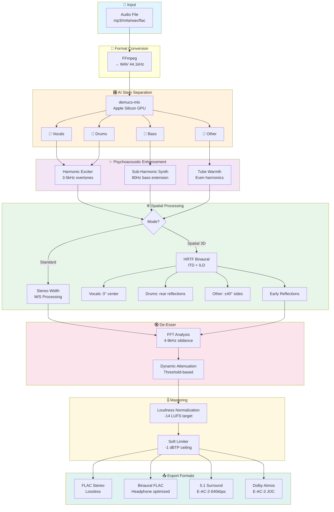
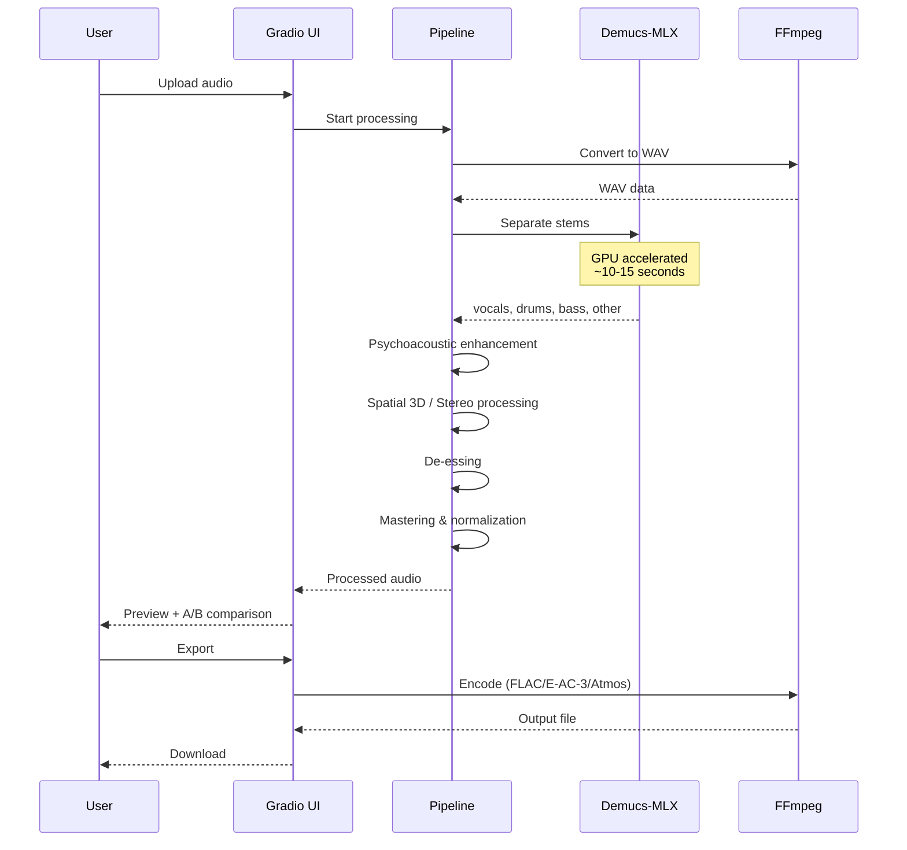
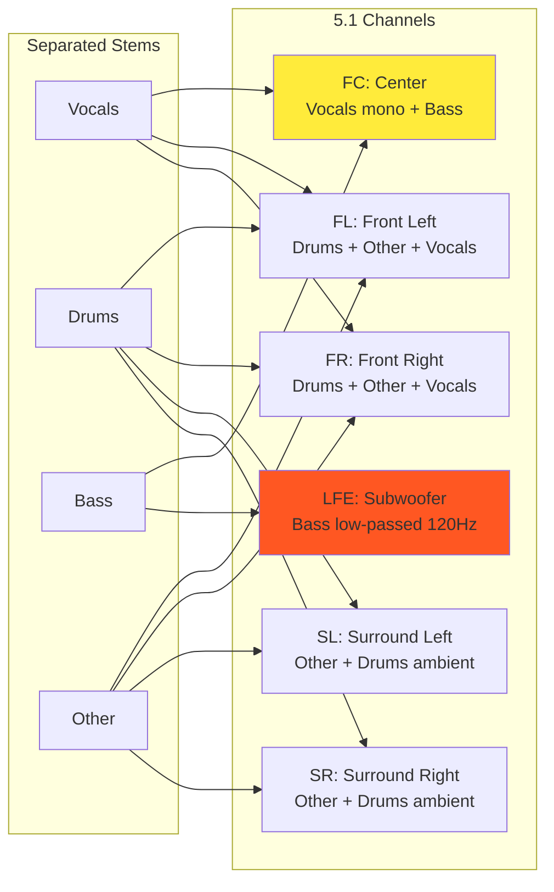

# Audio Upscaler

AI-powered audio enhancement pipeline with stem separation, psychoacoustic processing, and spatial audio.

## Architecture



## Processing Pipeline



## 5.1 Surround Channel Mapping



## Features

- **Stem Separation**: Isolate vocals, drums, bass, and instruments using demucs-mlx (Apple Silicon optimized)
- **Psychoacoustic Enhancement**: Harmonic exciter, sub-harmonic synthesis, tube warmth
- **Spatial 3D Processing**: HRTF binaural positioning for immersive headphone listening
- **De-esser**: FFT-based sibilance reduction calibrated to professional standards
- **Multi-format Export**: FLAC, Binaural, 5.1 Surround (E-AC-3), Dolby Atmos

## Presets

| Preset | Use Case |
|--------|----------|
| Studio Hip-Hop | Punch and clarity for hip-hop/rap (narrow stereo, -9 LUFS) |
| Spatial 3D | Immersive 3D soundstage for headphones |
| Wide & Bright | Enhanced stereo width and high frequencies |
| Podcast/Voice | Optimized for spoken word |

## Installation

```bash
# Clone
git clone https://github.com/ywrld14/audio-upscaler.git
cd audio-upscaler

# Create venv
python3 -m venv .venv
source .venv/bin/activate

# Install dependencies
pip install -r requirements.txt
```

## Usage

```bash
# Launch GUI
python audio_studio.py

# Open http://127.0.0.1:7860
```

## Requirements

- Python 3.10+
- macOS with Apple Silicon (for demucs-mlx acceleration)
- ffmpeg

## Dependencies

- `demucs-mlx` - AI stem separation
- `gradio` - Web UI
- `soundfile` - Audio I/O
- `scipy` - Signal processing
- `numpy` - Numerical operations
- `pyloudnorm` - Loudness metering
- `ac3forge` - Dolby Atmos encoding

## License

MIT
